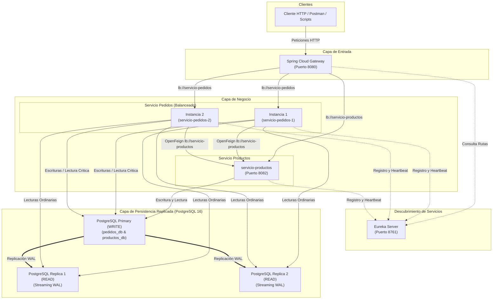

# Arquitectura de Microservicios con Descubrimiento Dinámico, Balanceo de Carga y Persistencia Replicada

**Universidad Estatal Península de Santa Elena (UPSE)**  
**Materia:** Aplicaciones Distribuidas  
**Equipo de Trabajo:**
* **Said Pinto**
* **Oscar Gonabay**
* **Jean Stalin**

---

## 1. Descripción del Sistema

Este proyecto implementa una arquitectura distribuida orientada a microservicios para la gestión de **Catálogo de Productos** y **Procesamiento de Pedidos**, diseñada para garantizar alta disponibilidad, balanceo de carga en capa de aplicación y persistencia replicada con tolerancia a fallos parciales.

### Características Principales:
* **Descubrimiento Dinámico de Servicios:** Implementado con **Spring Cloud Eureka Server**. Las instancias se registran dinámicamente y se resuelven mediante nombres lógicos sin depender de IPs o puertos fijos.
* **Punto Único de Entrada y Balanceo:** **Spring Cloud Gateway** actúa como API Gateway centralizado, integrando **Spring Cloud LoadBalancer** para balancear el tráfico HTTP entre múltiples instancias activas.
* **Comunicación Inter-servicio:** Comunicación síncrona declarativa mediante **Spring Cloud OpenFeign**, consultando el registro de Eureka para validar y descontar inventario en tiempo real.
* **Persistencia Replicada (PostgreSQL Streaming Replication):** Clúster con 1 nodo Primario (Master) y 2 Réplicas de Lectura (Standby) con sincronización mediante WAL (Write-Ahead Logging).
* **Enrutamiento Inteligente de Datos (Spring Boot):** Implementación de `DynamicRoutingDataSource` (extensión de `AbstractRoutingDataSource`) y `LazyConnectionDataSourceProxy`:
  * **Operaciones de Escritura:** Dirigidas al Primario (`postgres-primary`).
  * **Consultas Ordinarias:** Distribuidas equitativamente entre las réplicas (`postgres-replica-1` y `postgres-replica-2`).
  * **Lecturas Críticas (Read-After-Write):** Forzadas al Primario mediante la anotación `@CriticalRead` o la cabecera `X-Critical-Read: true` para garantizar consistencia inmediata y prevenir lectura de datos desactualizados por retraso de replicación.
  * **Tolerancia a Fallos de BD:** Un chequeo cada 2 s excluye la réplica que no responde. Si una consulta no obtiene conexión de una réplica caída aún no detectada, o la conexión se corta a mitad de una lectura ordinaria, la lectura se reintenta en la otra réplica (o en el primario si no queda ninguna), sin devolver error al cliente. Una réplica recuperada solo se reincorpora cuando está en modo standby y su receptor WAL está en `streaming`.
* **Resiliencia HTTP en el Gateway:** Timeout de conexión de 1 s y reintento automático en otra instancia cuando la conexión no llega a establecerse (instancia caída). No se reintenta ante respuestas 5xx, para no duplicar pedidos ni descuentos de stock.
* **Despliegue Contenedorizado:** Orquestación completa y reproducible con **Docker Compose**.

---

## 2. Diagrama de Arquitectura



---

## 3. Matriz de Puertos y Componentes

| Contenedor / Servicio | Imagen Base / Runtime | Puerto Host | Puerto Interno | Función |
| :--- | :--- | :--- | :--- | :--- |
| `eureka-server` | Eclipse Temurin 21 (JRE) | `8761` | `8761` | Servidor de Registro y Descubrimiento |
| `api-gateway` | Eclipse Temurin 21 (JRE) | `8080` | `8080` | Punto de entrada, Balanceo HTTP |
| `servicio-productos` | Eclipse Temurin 21 (JRE) | - | `8082` | Catálogo de productos e inventario |
| `servicio-pedidos-1` | Eclipse Temurin 21 (JRE) | - | `8081` | Instancia 1 de Pedidos y Enrutamiento DB |
| `servicio-pedidos-2` | Eclipse Temurin 21 (JRE) | - | `8081` | Instancia 2 de Pedidos y Enrutamiento DB |
| `postgres-primary` | PostgreSQL 16 Alpine | `5440` | `5432` | Base de Datos Primaria (Escrituras) |
| `postgres-replica-1`| PostgreSQL 16 Alpine | `5441` | `5432` | Réplica de Lectura 1 (Standby) |
| `postgres-replica-2`| PostgreSQL 16 Alpine | `5442` | `5432` | Réplica de Lectura 2 (Standby) |

---

## 4. Requisitos Previos

* **Docker Desktop** (Versión 24+ con Docker Compose v2).
* **PowerShell 7+ o Windows PowerShell** (para ejecución de scripts de prueba).
* No es indispensable tener Java ni Maven instalados localmente, ya que los Dockerfiles utilizan compilación multi-etapa (*multi-stage builds*).

---

## 5. Instrucciones de Despliegue y Ejecución

### Paso 1: Clonar el Repositorio
```powershell
git clone https://github.com/SaidJuniorProgrammer/-Microservicios.git
cd -Microservicios
```

### Paso 2: Configurar Variables de Entorno
El proyecto cuenta con un archivo `.env.example`. Copiarlo a `.env` si no existe:
```powershell
Copy-Item .env.example .env
```

### Paso 3: Compilar e Iniciar el Clúster
Ejecutar el comando de Docker Compose:
```powershell
docker compose up --build -d
```

### Paso 4: Verificar el Estado de los Contenedores
```powershell
docker compose ps
```
Verifique que los 8 contenedores se encuentren en estado `running` o `healthy`.

### Paso 5: Validar el Panel de Eureka
Abra en el navegador:
[http://localhost:8761](http://localhost:8761)
Debe observar registradas las aplicaciones:
* `API-GATEWAY`
* `SERVICIO-PRODUCTOS`
* `SERVICIO-PEDIDOS` (con 2 instancias activas: `servicio-pedidos-instancia-1` y `servicio-pedidos-instancia-2`).

---

## 6. Ejecución de Pruebas Experimentales (P01 a P08)

El directorio `scripts/` contiene scripts de PowerShell para automatizar y evidenciar los 8 escenarios obligatorios de la actividad:

```powershell
# Ejecutar todas las pruebas en secuencia:
.\scripts\run_all_tests.ps1

# O ejecutar pruebas individuales:
.\scripts\p01_descubrimiento.ps1        # P01: Registro y descubrimiento dinámico en Eureka
.\scripts\p02_balanceo_http.ps1          # P02: Balanceo de 100 solicitudes HTTP via Gateway
.\scripts\p03_fallo_instancia.ps1        # P03: Tolerancia a fallo y recuperación de microservicio
.\scripts\p04_comunicacion_servicios.ps1 # P04: Comunicación Feign entre microservicios
.\scripts\p05_enrutamiento_db.ps1        # P05: Enrutamiento Primario (Write) vs Réplicas (Read)
.\scripts\p06_fallo_replica.ps1          # P06: Tolerancia a fallo de réplica PostgreSQL
.\scripts\p07_consistencia_lectura.ps1   # P07: Consistencia de lectura crítica inmediata
.\scripts\p08_recuperacion_replica.ps1   # P08: Recuperación y reincorporación de réplica
```

Consulte el documento [INFORME_PRUEBAS.md](INFORME_PRUEBAS.md) para el análisis técnico detallado y las evidencias de cada prueba. La salida completa de una ejecución real de la suite se encuentra en [evidencias/ejecucion_p01_p08.txt](evidencias/ejecucion_p01_p08.txt).

> **Nota:** P06 deja `postgres-replica-1` detenida y P08 la reinicia; ejecútelas en ese orden (o use `run_all_tests.ps1`). Las IPs de los contenedores pueden variar entre equipos.

---

## 7. Procedimiento de Detención y Limpieza

Para detener el entorno conservando datos:
```powershell
docker compose stop
```

Para reiniciar o destruir los contenedores y volúmenes:
```powershell
docker compose down -v
```

---

## 8. Colección de Pruebas Postman

En la raíz del proyecto se encuentra el archivo:
[microservicios_postman_collection.json](microservicios_postman_collection.json)
Importe este archivo en Postman o Bruno para probar de forma interactiva todas las operaciones REST documentadas.

---

## 9. Enlace del Video Demostrativo

* **Enlace de YouTube / Drive:** `https://1drv.ms/v/c/b4a4ebd0e9c3a318/IQANshiIsqnWTqZvr0MuXlA0Ab_EATvtzR5gMqzAxoac7sI?e=CAIa8e`
* **Duración:** 10 minutos y 37 segundos.
* **Participantes:** Oscar Gonabay, Jean Stalin y Said Pinto.
* Consulte el [GUION_VIDEO.md](GUION_VIDEO.md) para la estructura de la presentación.
